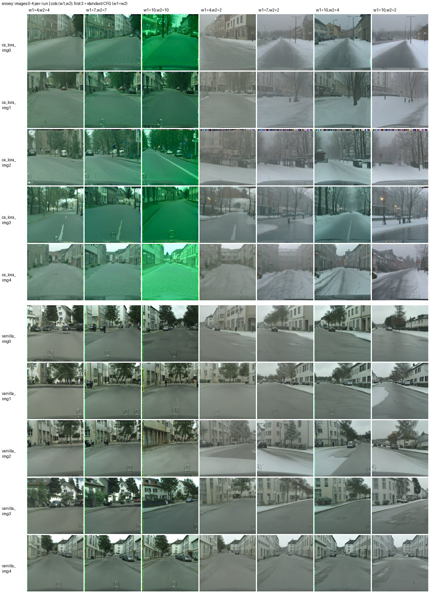

# Hierarchical CFG

[English](README.md) | **한국어**

**파인튜닝된 확산 모델의 망각 문제를 피하기 위한 가이던스 분리.**

소량의 타겟 이미지로 T2I 모델을 파인튜닝하면 trade-off가 생긴다. 모델은 타겟 **도메인**(여기서는
Cityscapes 거리 풍경의 느낌)을 배우는 대신 **제어성**을 잃는다. "in snowy weather"나 "a green truck on
the road" 같은 프롬프트가 더 이상 반영되지 않는다. 계층적 CFG는 이 문제를 재학습 없이 샘플링
단계에서 다룬다. classifier-free guidance 항을 **도메인** 방향과 **refine**(제어성) 방향으로 나누고,
각각에 별도의 가중치를 준다.

최종 리포트:
[`docs/Hierarchical CFG - Separate Guidance to Avoid Forgetting Problem.md`](docs/Hierarchical%20CFG%20-%20Separate%20Guidance%20to%20Avoid%20Forgetting%20Problem.md)



*프롬프트 `Photorealistic first-person urban street view, in snowy weather`, style CA-LoRA(위)와
vanilla LoRA(아래) 각 5장. 앞의 세 열은 일반 CFG(w1 = w2 = 4, 7, 10), 뒤의 네 열은 w1 > w2인 계층적
CFG다. 모든 열이 같은 초기 노이즈에서 시작한다.*

## 방법

c = 파인튜닝에 쓴 도메인 프롬프트, c_refine = c + 제어 문구
(`"Photorealistic first-person urban street view"` → `"..., in snowy weather"`)라고 하자. 모든
ε-prediction은 같은 (z_t, t)에서 계산한다.

| | |
|---|---|
| G_domain = ε(FT, c) − ε(FT, ∅) | 도메인 가이던스 |
| G_refine = ε(FT, c_refine) − ε(FT, c) | refine(제어성) 가이던스 |
| Diff_∅ = ε(FT, ∅) − ε(Base, ∅) | 파인튜닝이 무조건부 브랜치에 남긴 변화 |

일반 CFG는 ε(FT, ∅) + w·(G_refine + G_domain)으로, 두 방향에 같은 가중치를 쓴다. 계층적 CFG는 이를
분리한다.

| 방식 (`hcfg.variant`) | ε̂ |
|---|---|
| 기본형 (`basic`) | ε(FT, ∅) + w1·G_refine + w2·G_domain |
| 도메인 대안형 (`alt_domain`) | ε(Base, ∅) + w1·G_refine + w2·(G_domain + Diff_∅) |
| 제어성 대안형 (`alt_refine`) | ε(FT, ∅) + w1·G_refine^Base + w2·G_domain |

w1은 refine 강도, w2는 도메인 강도다. w1 = w2이면 기본형은 일반 CFG와 **같다**. 그래서 모든 (w1, w2)
그리드의 대각선이 같은 시드의 baseline이 된다. 한 스텝의 모든 브랜치는 UNet에 한 배치로 들어가고,
Base 브랜치는 같은 UNet에서 어댑터를 끈 상태로 계산한다.

**용어 주의:** 리포트는 무조건부 조건을 ∅로 썼고, 코드와 연구 문서는 `null`, Null, uncond, φ라고
불렀다. 모두 같은 것이다. 전체 대응표는
[`docs/Implementation detail.md`](docs/Implementation%20detail.md) 0장에 있다.

## 실험과 결과

- **모델·데이터:** SDXL base 1.0을 같은 Cityscapes train 10장으로 다섯 가지 방식으로 파인튜닝했다.
  vanilla LoRA(r = 64), style CA-LoRA, style CA-LoRA + condition dropout, DreamBooth LoRA(r = 64),
  Textual Inversion.
- **그리드:** (w1, w2) ∈ {1, 2, 4, 7, 10}², 제어 프롬프트 5개(눈, 안개, 밤, 녹색 트럭, 파란 SUV + 빨간
  오토바이), 셀·프롬프트당 20장. (파인튜너, 방식) 10쌍에서 25,000장, Diff_∅ 분리 실험 900장을 생성했다.
- **채점:** LLM 서브에이전트가 이미지를 직접 보고 도메인 정합성(D ↑), 제어성(C ↑), 붕괴(K ↓)를 0–10으로
  채점했다.

주요 결과(리포트 6–9장):

- **일반 CFG로는 도메인과 제어성을 맞바꿀 수 없다.** w1 = w2 대각선에서 LoRA 계열의 C는 w와 무관하게
  2.4를 넘지 않았다(CA-LoRA + dropout만 3–4).
- **가중치를 분리하면 제어성이 돌아온다.** 같은 품질 제약에서 계층적 CFG의 최대 제어성은 일반 CFG보다
  3–6점 높다. 예: D ≥ 7, K ≤ 3에서 DreamBooth LoRA는 C 0.97(일반 CFG)에서 (w1, w2) = (7, 2)의 5.76으로
  올랐다. D ≥ 5, K ≤ 4에서 style CA-LoRA 제어성 대안형은 (4, 2)에서 C 7.87에 도달했다.
- **실용 영역:** w2 ∈ [2, 4], w1/w2 ≥ 2이며, 대부분의 모델에서 (7, 2)가 최상위 셀이다. 진단에서는
  파인튜닝이 ‖G_refine‖/‖G_domain‖을 Base의 0.4–0.65배로 줄여 w1/w2 ≈ 1.5–2.5가 필요하다고 예측했다.
- **붕괴는 w2가 결정한다.** Diff_∅ = 0인 Textual Inversion을 포함한 모든 모델에서, w2 ≥ 4부터 녹색 색조와
  테두리 노이즈가 나타난다. Diff_∅에서 도메인 방향과 직교하는 성분을 제거해도 붕괴는 줄지 않았다
  (negative result, 리포트 7장).

**한계:** 생성 결과는 모두 단일 시드에 대한 LLM 육안 채점에 근거한다. 계획했던 정량 평가
(P(Cityscapes | x) 분류기, zero-shot 검출)는 하지 않았다.

## 빠른 시작

```bash
python -m venv .venv && source .venv/bin/activate      # Windows: .venv\Scripts\activate
pip install -e ".[dev]"
python -m pytest -q                                    # CPU, tiny 랜덤 모델, 다운로드 없음
python scripts/smoke_test.py                           # tiny 모델로 전체 단계 실행
```

GPU(A100 80 GB 사용)에서, Cityscapes를 받은 뒤:

```bash
DATA=(data.image_dir=/path/to/cityscapes/leftImg8bit/train data.image_list=configs/data/train10.txt)
python scripts/train.py --config configs/vanilla_lora.yaml --set "${DATA[@]}"                 # 약 70분
python scripts/sweep.py --config configs/vanilla_lora.yaml \
    --set "hcfg.cells=[[7,2]]" "hcfg.keys=[snowy]"                                          # 한 셀
python scripts/sweep.py --config configs/vanilla_lora.yaml                                   # 5x5 전체
```

다섯 파인튜너, 진단, 대안형, Diff_∅ 분리 실험, 소요 시간·용량을 포함한 전체 재현 절차는
[`docs/REPRODUCE.md`](docs/REPRODUCE.md)(영문)에 있다.

## 디렉터리 구조

```
configs/    base.yaml(공통) + 파인튜너별 설정(inherit: base.yaml), prompts.yaml,
            data/train10.txt(학습 이미지 10장), selections/(CA-LoRA head selection),
            tiny_cpu.yaml(CPU 테스트)
src/hcfg/   models/       SDXL 래퍼, sliced(head 단위) LoRA, Textual Inversion, 테스트용 tiny 모델
            train/        다섯 파인튜너 학습
            generation/   일반 CFG, 계층적 CFG 샘플러(hierarchical.py), (w1, w2) 그리드
            diagnostics/  같은 (z_t, t)에서 G_refine / G_domain / Diff_∅ 측정
            eval/         CMMD, CLIP score, CLIP zero-shot, OWLv2 검출
            ca/           CA-LoRA head 민감도 측정
scripts/    train, generate, evaluate, sweep, diagnose, plot_diagnostics, measure_ca,
            gpu_check, smoke_test
tests/      tiny 모델 기반 단위·end-to-end 테스트
results/    리포트의 근거 요약: 학습 요약·loss 곡선, 진단 요약·그림, GPU 검증 로그, 학습 데이터 해시
docs/       리포트와 보조 문서(아래)
```

## 문서

| 파일 | 내용 |
|---|---|
| [`docs/Hierarchical CFG - Separate Guidance to Avoid Forgetting Problem.md`](docs/Hierarchical%20CFG%20-%20Separate%20Guidance%20to%20Avoid%20Forgetting%20Problem.md) | 최종 리포트 |
| [`docs/sample_observation_report_CLAUDE.md`](docs/sample_observation_report_CLAUDE.md) | 생성 이미지 25,900장 채점 결과: 채점 기준, 5x5 그리드 전체, 프롬프트별 분석 |
| [`docs/sample_observation_scores_CLAUDE.csv`](docs/sample_observation_scores_CLAUDE.csv) | 이미지별 점수(모델, 방식, 프롬프트, w1, w2, λ, 파일, D, C, K, 짧은 메모) |
| [`docs/diagnostics.md`](docs/diagnostics.md) | 사전 진단 결과 상세 분석 |
| [`docs/Implementation detail.md`](docs/Implementation%20detail.md) | 구현 규칙, 리포트 ↔ 코드 용어 대응표 |
| [`docs/REPRODUCE.md`](docs/REPRODUCE.md) | 단계별 재현 가이드(영문) |

## 라이선스

이 레포의 코드는 [MIT License](LICENSE)로 공개한다. 이 라이선스는 레포 안의 코드와 문서에만
적용된다. 다음은 레포에 **포함되지 않으며** 각자의 조건을 따른다.

- **SDXL 가중치**(`stabilityai/stable-diffusion-xl-base-1.0`)는 실행 시 내려받으며 CreativeML Open
  RAIL++-M License를 따른다. 파인튜닝된 가중치(LoRA / Textual Inversion)는 SDXL의 파생물이다. 이 레포는
  이를 배포하지 않으며, 이런 가중치를 공개하려면 그 라이선스의 사용 제한 조항을 따라야 한다.
- **Cityscapes** 이미지는 포함하지 않는다(파일명과 해시만 있음).
  <https://www.cityscapes-dataset.com/>에서 Cityscapes 이용 약관에 따라 받아야 한다.
- `results/`의 이미지는 이 연구를 위해 생성한 SDXL 출력물이다.
- `configs/ca_augmentations.json`과 `configs/selections/ref_style_t81.json`은 CA-LoRA 레퍼런스
  구현(chs35/Improving-CA-LoRA)에서 가져왔다.
