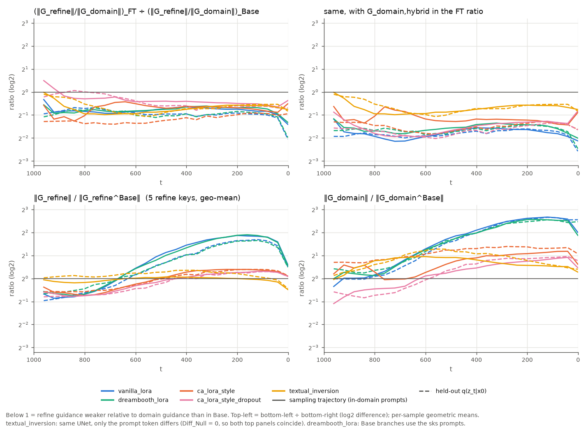

# 진단 결과 분석

- 작성: 2026-09-29. 진단(최종 리포트 3장)을 마친 직후, 대안형 스윕을 실행하기 **전에** 쓴 분석 문서다. 대안형 스윕·육안 평가를 반영한 최종 판단은 최종 리포트(`docs/Hierarchical CFG - Separate Guidance to Avoid Forgetting Problem.md`) 5–6장을 따른다. 이 문서의 7장 "모델별 제안"은 스윕 전 시점의 제안이다.
- 목적: 진단 결과로 (1) 어떤 모델을 대안형 CFG로 생성해야 하는지, (2) 어떤 모델에 φ-anchoring 재학습이 필요한지 정하고, 연구 구상 단계의 가설(H1–H3, G_refine 축소)의 근거를 정리한다.
- 원자료: `results/diagnostics/<run>_summary.json`, `results/diagnostics/gpu_check.txt`(GPU 검증 로그), `runs/<run>/diagnostics/{records.jsonl,tensors/,trajectory_images/}`, 기본형 스윕 `runs/<run>/hcfg/basic/`. `runs/`는 용량 때문에 레포에 포함하지 않았다.
- 3.2절과 5장의 수치는 위 원자료에서 임시 스크립트로 계산했다(레포에 스크립트 없음). 계산식은 부록에 있다.
- 표기: φ와 ∅는 같은 것(무조건부 조건, 코드의 `null`)이다. 용어 대응은 `docs/Implementation detail.md` 0장 참고.

## 요약

1. **Diff_Null은 무작위 차이가 아니라 도메인 지식이다 (H1 지지, H3 반박).** held-out Cityscapes에서 ε(FT,∅)가 ε(Base,∅)보다 노이즈를 더 잘 맞힌다(high t에서 이미지의 83–100%). 예외는 vanilla·DreamBooth의 low t로, 방향은 맞지만 크기가 과하다(과적합).
2. **도메인 지식이 있는 브랜치가 모델마다 다르다.** vanilla·DreamBooth·CA+dropout은 ∅ 브랜치(Diff_Null)에, style CA-LoRA·TI는 c 브랜치(G_domain)에 있다. vanilla·DreamBooth의 G_domain은 held-out에 일반화되지 않는다.
3. **파인튜닝은 ‖G_refine‖/‖G_domain‖을 Base의 약 0.4–0.65배로 줄인다.**
   - 원인은 t 구간마다 다르다: mid/low t에서는 주로 G_domain이 커져서, high t에서는 G_refine이 작아져서 줄어든다.
   - 예외처럼 보이는 CA+dropout high t는 도메인 정렬이 ∅로 옮겨간 경우다. G_domain,hybrid 기준으로는 다른 LoRA처럼 약 0.3배로 준다.
   - UNet이 Base와 같은 TI도 0.55–0.7배다.
4. **계층적 CFG의 핵심 주장은 이미지에서 확인됐다.** style CA-LoRA 기본형 스윕에서 일반 CFG(w1 = w2)는 w와 무관하게 눈을 만들지 못하고(0/15), w1 > w2에서는 모두 눈이 덮인다(15/15). 이때 필요한 w1/w2(약 1.75–2 이상)는 비율로 예측한 1/ρ(1.5–2.5)와 맞는다.
5. **"G_refine 축소" 가설은 절반만 맞다.** high t에서만 줄고 t 평균은 커진다. style CA-LoRA의 날씨 제어 상실은 재현되지만, G_refine의 크기·방향·비율 어느 것으로도 날씨와 차종의 차이가 설명되지 않는다.
6. **1차 제안:**
   - 생성: style CA-LoRA는 기본형, vanilla·DreamBooth·CA+dropout은 대안형(domain) 검증, vanilla는 대안형(refine)도 검증.
   - φ-anchoring: H3 모델이 없어 필수 대상은 없다. 유일한 후보는 style CA-LoRA이며, 대안형(domain)이 기본형보다 나을 때만 해당한다.

## 1. 데이터와 표기

| 항목 | 내용 |
|---|---|
| held-out (`forward`) | train10 밖 Cityscapes 20장, 노이즈 seed 0, q(z_t\|x0) |
| 궤적 (`trajectory`) | FT 모델의 일반 CFG(w = 5) 샘플링, Euler 25스텝, 7 프롬프트 × 시드 4 × 2장 = 도메인 궤적 48개 + control(과일 그릇) 궤적 8개 |
| t 구간 | high 961–641 (9스텝) / mid 601–321 (8스텝) / low 281–1 (8스텝) |
| 프롬프트 | DreamBooth는 Base 브랜치도 `with sks style` 프롬프트를 쓴다. TI의 FT는 Base UNet + `<s*>` 프롬프트이고, Base 브랜치는 기본 프롬프트다 |
| 주의 | style CA-LoRA의 t = 961 값은 bf16 오차 영향이 크다. 같은 Base ε(∅)를 배치 구성만 바꿔 계산한 bf16 차이를 실측 ms_diff_null로 나누면 style CA-LoRA ≤ 0.074(궤적 t = 961만 0.188), dropout ≤ 0.038, vanilla ≤ 0.016이다(무작위 z 기준 값은 `results/diagnostics/gpu_check.txt`의 D1c) |

표기: D = Diff_Null, G_r = G_refine, G_d = G_domain, 위첨자 B = Base.

## 2. 해석의 전제 두 가지

### 2.1 Diff_Null은 attn1(self-attn) LoRA에서만 생긴다

- 이 프로젝트의 ∅는 zeros다(`model.uncond: zeros`). SDXL attn2의 `to_k`/`to_v`/`to_q`에는 bias가 없고 `to_out`에만 있다(체크포인트 확인). LoRA delta에도 bias가 없다(`models/lora.py`).
- 따라서 ∅ 브랜치에서 attn2는 K = V = 0이 되어 출력이 `to_out` bias로 고정되고, attn2 LoRA(q/k/v/out)가 ∅ 출력에 주는 영향은 연산상 정확히 0이다.
- Diff_Null의 출처: vanilla·DreamBooth는 attn1 LoRA 모듈 280개(전체 560개 중), style CA-LoRA·CA+dropout은 65개 중 attn1 21개(head slice).
- 함의:
  - φ-anchoring 규제항의 gradient는 attn1 LoRA에만 흐른다. φ-anchoring 규제항을 구상할 때의 "LoRA가 cross-attention에 몰려 있으면 유효 용량이 줄 수 있다"는 우려는 uncond가 zeros인 한 해당되지 않는다.
  - attn1을 LoRA 대상에서 빼면 규제항 없이도 D ≡ 0이 된다(구조적 anchoring).
  - uncond를 `empty`(빈 문자열 인코딩)로 바꾸면 이 성질은 사라진다.

### 2.2 대안형(domain) = 기본형 + (w2 − 1)·D

- 식을 전개하면: ε(Base,∅) + w1·G_r + w2·(G_d + D) = ε(FT,∅) + w1·G_r + w2·G_d + (w2 − 1)·D.
- w2 = 1이면 두 형태가 같다. 대안형(domain) 스윕의 w2 = 1 행은 기본형 결과를 재사용할 수 있다.
- ‖G_d,hybrid‖/‖G_d‖ = 1.1–3.1이라 같은 w2에서는 가이던스 크기가 다르다. 두 형태는 같은 w2끼리가 아니라 Pareto 프론티어로 비교해야 한다.
- cos(D, G_d)가 낮은 것(t 평균 < 0.2)은 H3의 근거가 아니다. D가 G_d와 평행하면 대안형은 "w2를 키운 기본형"에 불과하다. 따라서 낮은 cos는 두 형태가 달라질 수 있는 전제 조건일 뿐이다.

## 3. Diff_Null — H1/H2/H3

연구 구상 단계에서 Diff_Null에 대해 세운 세 가설이다.

- **H1**: Diff_Null은 충분히 크고 도메인 지식을 담은 좋은 guidance다 → G_domain,hybrid가 G_domain보다 낫다.
- **H2**: Diff_Null은 작아서 의미 있는 guidance가 아니다(학습 head가 적은 CA-LoRA에서 가능성이 높다) → G_domain,hybrid ≈ G_domain.
- **H3**: Diff_Null은 작지 않지만 학습 중 우연히 생긴 무작위 차이다 → G_domain,hybrid가 G_domain보다 나쁘다.

### 3.1 크기와 방향

| run | ‖D‖/‖G_d‖ (t 평균, held-out / 궤적) | 샘플 간 방향 일관성, high t (D / G_d) | ‖D‖ 비: 도메인 궤적 ÷ control 궤적 |
|---|---|---|---|
| vanilla | 1.40 / 1.58 | 0.51 / 0.14 | 1.66배 |
| DreamBooth | 1.10 / 1.29 | 0.46 / 0.19 | 2.29배 |
| style CA | 0.67 / 0.81 | 0.17 / 0.71 | 2.40배 |
| CA+dropout | 2.12 / 1.74 | 0.67 / 0.14 | 1.91배 |
| TI | 0 (정확히) | — / 0.62 | — |

- 샘플 간 방향 일관성은 샘플 쌍의 평균 cos이다(`cross_cos`, held-out).
- D는 도메인 궤적에서 control 궤적보다 1.7–2.4배 크다. 즉 입력이 도메인일 때 커지는 성분이다.

### 3.2 held-out 노이즈 제거 테스트 (추가 분석)

방법:
- held-out 입력은 z_t = √ᾱ·x0 + √(1−ᾱ)·ε다. 참 ε는 `forward_noise(0, image, shape)`로 그대로 재현된다.
- 저장된 텐서 ε(FT,∅)·ε(Base,∅)·G_d로 오차 ‖ε − ε̂‖²를 비교한다. ε(FT,c) = ε(FT,∅) + G_d다.
- 이득은 Base(∅) 대비 오차 감소율을 20장에 합산한 값이다.

| run | 이득: ε(FT,∅) (high / mid / low) | 이득: ε(FT,c) (high / mid / low) | cos(D, ε − ε(Base,∅)) | s*_D / s*_Gd (low t) |
|---|---|---|---|---|
| vanilla | +4.6 / +0.2 / −1.1% | +3.0 / −2.6 / −3.2% | 0.25 / 0.13 / 0.07 | 0.35 / 0.03 |
| DreamBooth | +4.7 / +0.9 / −0.3% | +3.3 / −1.6 / −2.1% | 0.24 / 0.13 / 0.07 | 0.43 / 0.08 |
| style CA | +1.5 / +0.9 / +0.3% | +5.5 / +1.8 / +0.6% | 0.11 / 0.10 / 0.05 | 0.83 / 0.79 |
| CA+dropout | +5.1 / +1.5 / +0.4% | +5.4 / +1.7 / +0.6% | 0.25 / 0.13 / 0.06 | 0.83 / 0.80 |
| TI | 0 | +4.9 / +1.3 / +0.2% | — | — / 0.95 |

- s* = ⟨r, v⟩/‖v‖²는 벡터 v를 기준점에 몇 배 더할 때 오차가 최소인지를 뜻한다. 1이면 크기가 맞고, 0.5 미만이면 1배로 더할 때 오차가 오히려 커진다.
  - s*_D: 기준점 ε(Base,∅), r = ε − ε(Base,∅).
  - s*_Gd: 기준점 ε(FT,∅), r = ε − ε(FT,∅).
- high t에서 D가 오차를 줄인 이미지 비율: vanilla 100%, DreamBooth 100%, style CA 83%, CA+dropout 100%.

### 3.3 판정

- **H3 (무작위 차이): high·mid t에서 반박.**
  - 무작위 교란이라면 기대값으로 오차를 ‖D‖²만큼 키워야 한다. 실제로는 D가 오차를 줄이고, 65,536차원 latent에서 참 잔차와 cos 0.11–0.25를 보인다.
  - 예외: vanilla·DreamBooth의 low t에서는 방향은 맞지만 크기가 2–3배 과하다(s*_D 0.35–0.43). low t에 한해 과적합 성분으로 본다.
- **H1 (좋은 도메인 가이던스): vanilla·DreamBooth·CA+dropout에서 지지.**
  - vanilla·DreamBooth는 G_d가 held-out에 일반화되지 않는다. ε(FT,c)가 mid/low t에서 Base(∅)보다도 나쁘고, s*_Gd는 0.02–0.34다. 궤적 이미지에서 프롬프트와 무관하게 같은 장면이 반복되는 과적합 양상과 합치면, 일반화되는 도메인 지식은 G_d가 아니라 D에 있다. 학습 이미지와의 1:1 대조는 하지 않았다.
  - CA+dropout은 도메인 이득의 73–94%가 ∅에 있고, high t의 G_d는 Base의 0.65–0.70배로 줄었다. condition dropout이 도메인 지식을 G_d에서 D로 옮긴 것이므로 H1의 양성 대조군이다.
- **H2 (작아서 무시 가능): style CA-LoRA에서 부분 지지.**
  - attn1 모듈이 적어 D의 mean square가 vanilla의 1/6–1/11이다.
  - 하지만 ‖G_d‖ 대비로는 0.47–0.96이고 도메인 이득 중 ∅의 몫이 27–48%다. "무시 가능"한지는 스윕으로 확인해야 한다.

### 3.4 seed 일관성 기준에 대한 의견

구상 단계의 판별 기준은 "샘플링 seed 간 Diff_Null이 비슷하면 H1, 많이 다르면 H3"였다.

- 샘플링 시드 간 ‖D‖/‖G_d‖의 cv는 0.03–0.07로 작다. 이 기준대로라면 모든 LoRA가 H1이다.
- 하지만 고정된 가중치 교란이라면 무엇이든 시드 간 크기가 일정하게 나오므로, 이 기준은 H1과 H3를 가르는 힘이 없다.
- H3가 말하는 "우연성"은 학습의 우연성이다. 제대로 보려면 학습 시드를 바꿔 재학습하고, D의 방향이 같게 나오는지 확인해야 한다.
- 재학습 없이 쓸 수 있는 대안은 3.2절의 held-out 노이즈 제거 테스트다.

## 4. G_refine — 크기와 방향 (최종 리포트 3.1)

### 4.1 크기: ‖G_r‖²/‖G_r^B‖² (held-out, 5개 키의 범위)

| run | high | mid | low |
|---|---|---|---|
| vanilla | 0.36–0.67 | 2.2–4.2 | 5.5–10.4 |
| DreamBooth | 0.53–0.88 | 2.0–4.9 | 5.0–9.8 |
| style CA | 0.27–0.72 | 0.65–1.28 | 1.2–1.9 |
| CA+dropout | 0.23–0.58 | 0.60–1.10 | 1.1–1.5 |
| TI | 0.56–1.85 | 1.0–2.3 | 1.0–1.2 |

모든 LoRA에서 G_refine은 high t(전역 속성이 정해지는 구간)에서만 줄어든다. t 평균으로는 오히려 커지므로, "파인튜닝 후 L_concept(= ‖G_refine‖²)는 실제로 줄어드는가"라는 질문의 답은 "high t에서만"이다.

### 4.2 방향: cos(G_r, G_r^B)

- TI는 UNet이 Base와 같고 프롬프트 문구만 다른데도 cos가 0.16–0.54다. 이 값을 "같은 UNet, 다른 문구"의 기준선으로 본다.
- CA 계열(0.16–0.47)은 기준선 수준이다.
- vanilla·DreamBooth는 mid/low t에서 0.04–0.13으로 기준선보다 확실히 낮다.

### 4.3 정렬 성분 β = √(‖G_r‖²/‖G_r^B‖²) · cos(G_r, G_r^B)

- "크기냐 방향이냐"로 나누는 대신, FT의 G_r 중 Base refine 방향 성분이 얼마나 되는지를 ‖G_r^B‖ 단위로 본다.
- high t 궤적 기준 β:

  | run | 5개 키 범위 | snowy |
  |---|---|---|
  | vanilla | 0.06–0.19 | 0.12 |
  | DreamBooth | 0.09–0.30 | — |
  | style CA | 0.09–0.35 | 0.28 |
  | CA+dropout | 0.14–0.35 | — |
  | TI | 0.24–0.55 | 0.55 |

- 이미지와 대조하면 대략 w1·β ≈ 2에서 눈이 뚜렷해진다:

  | 경우 | w1·β | 이미지 |
  |---|---|---|
  | TI, w = 5 | 2.8 | 눈 뚜렷 |
  | style CA, w1 = 7 | 2.0 | 눈 덮임 |
  | style CA, w1 = 4 | 1.1 | 약함 |
  | vanilla, w1 = 10 | 1.2 | 약함 |

  이미지 몇 장에서 나온 가설이므로 정량 평가에서 검증한다.

### 4.4 style CA-LoRA의 날씨 상실 (최종 리포트 1장)

- 현상은 이미지로 재현된다. w = 5 일반 CFG에서 날씨는 반영되지 않고 차량은 일부 반영된다.
- 그러나 ε 공간 지표에서는 날씨가 더 망가졌다는 신호가 없다(high t 기준):
  - 크기: 날씨 0.41–0.66, 트럭 0.27.
  - cos: 날씨 0.44–0.47, 차량 0.16–0.26.
  - 5장의 비율 ρ: 트럭 0.30, 날씨 0.37–0.47.
- 대안 해석(미검증):
  - CA의 G_d에는 샘플과 무관한 전역 성분이 크다(샘플 간 cos 0.71).
  - 스윕에서 초록 색조는 w1과 무관하게 w2 ≥ 7에서만 나타난다.
  - 즉 전역 스타일 방향이 w2배로 증폭되면서, 같은 전역 속성인 날씨를 덮는다는 해석이다.
  - 검증 방법: 키별 cos(G_refine, G_domain) 측정(실행하지 않음).

## 5. ‖G_refine‖/‖G_domain‖ 비율의 변화 (추가 분석)

검증할 가설: 파인튜닝이 도메인에 정렬되는 과정에서 ‖G_r‖/‖G_d‖가 줄어든다.

### 5.1 정의

- ρ = (‖G_r‖/‖G_d‖)_FT ÷ (‖G_r^B‖/‖G_d^B‖)_Base. 같은 z_t에서 샘플별로 계산하고 기하평균한다(키 5개도 기하평균).
- 로그 분해: log ρ = log(‖G_r‖/‖G_r^B‖) − log(‖G_d‖/‖G_d^B‖). 비율이 줄어든 원인이 G_r 축소인지 G_d 증가인지를 나눈다.
- ρ_hyb: FT 쪽 G_d 자리에 G_d,hybrid(= G_d + D, Base ∅를 기준으로 한 도메인 변화 전체)를 넣은 값.
- 신뢰구간: 샘플(held-out 이미지 20개 / 도메인 궤적 48개) 부트스트랩 95%.

### 5.2 결과

held-out 결과 (high / mid / low):

| run | ρ | ρ의 95% CI | ‖G_r‖/‖G_r^B‖ | ‖G_d‖/‖G_d^B‖ | ρ_hyb |
|---|---|---|---|---|---|
| vanilla | 0.58 / 0.51 / 0.46 | [0.53, 0.62] / [0.48, 0.54] / [0.44, 0.49] | 0.66 / 1.69 / 2.73 | 1.15 / 3.32 / 5.92 | 0.27 / 0.29 / 0.29 |
| DreamBooth | 0.56 / 0.49 / 0.48 | [0.51, 0.60] / [0.45, 0.53] / [0.45, 0.51] | 0.77 / 1.67 / 2.65 | 1.39 / 3.42 / 5.53 | 0.32 / 0.31 / 0.32 |
| style CA | 0.40 / 0.43 / 0.51 | [0.37, 0.44] / [0.40, 0.47] / [0.48, 0.54] | 0.69 / 1.01 / 1.25 | 1.74 / 2.37 / 2.48 | 0.36 / 0.32 / 0.38 |
| CA+dropout | **0.94** / 0.67 / 0.64 | **[0.86, 1.02]** / [0.63, 0.71] / [0.61, 0.67] | 0.61 / 0.91 / 1.17 | 0.65 / 1.37 / 1.84 | 0.30 / 0.28 / 0.36 |
| TI | 0.70 / 0.55 / 0.65 | [0.65, 0.76] / [0.50, 0.60] / [0.60, 0.73] | 1.07 / 1.23 / 1.04 | 1.52 / 2.23 / 1.59 | ρ와 같음 |

도메인 궤적 결과:

| run | ρ | ρ_hyb |
|---|---|---|
| vanilla | 0.54–0.60 | 0.27–0.31 |
| DreamBooth | 0.57–0.61 | 0.32–0.35 |
| style CA | 0.57–0.65 | 0.42–0.51 |
| CA+dropout | 0.70–0.91 (high t 0.91 [0.87, 0.96]) | 0.32–0.42 |
| TI | 0.57–0.65 | ρ와 같음 |

ρ < 1인 샘플 비율: CA+dropout high t(held-out 65%, 궤적 69%)를 빼면 모든 모델·구간에서 94–100%.

비율의 절대값 (held-out):
- Base의 ‖G_r^B‖/‖G_d^B‖는 키와 t에 따라 0.47–0.87이다. DreamBooth의 sks 프롬프트로는 0.41–0.79.
- FT에서는 vanilla 0.21–0.46, DreamBooth 0.19–0.41, style CA 0.24–0.38, CA+dropout 0.31–0.72, TI 0.31–0.61.

### 5.3 해석

1. **가설은 지지된다.** 모든 파인튜너에서 비율이 Base의 약 0.4–0.65배로 줄고, 부트스트랩 CI도 1 아래에 있다(CA+dropout high t의 held-out만 예외).
2. **줄어드는 방식은 t 구간마다 다르다.**
   - high t: 모든 LoRA에서 G_r이 작아진다(0.61–0.77배). 전역 레이아웃이 정해지는 구간에서 refine 반응이 억제된다. vanilla·DreamBooth는 G_d가 조금만 커져서(1.15–1.39배) G_r 축소가 주된 원인이고, style CA는 G_d도 1.74배로 커져 두 가지가 함께 작용한다.
   - mid/low t: G_r도 커지지만(vanilla 1.7–2.7배) G_d가 더 크게 커진다(3.3–5.9배). 도메인 반응의 증폭이 주된 원인이다.
3. **CA+dropout은 예외처럼 보이지만 같은 현상이다.**
   - high t에서 G_d가 Base의 0.65배로 줄어 비율이 유지된다. 도메인 정렬이 G_d가 아니라 ε(FT,∅)(즉 D)로 갔기 때문이다(3.2절).
   - ∅ 쪽 변화까지 포함한 ρ_hyb는 0.28–0.36으로 다른 LoRA와 같다.
   - 즉 "도메인 정렬 → 비율 감소"는 도메인 가이던스를 G_d,hybrid로 재면 모든 LoRA에서 성립한다.
4. **UNet 가중치 변화가 필수는 아니다.** TI는 UNet이 Base와 같은데도 ρ = 0.55–0.70이다(`<s*>` 토큰이 G_d를 1.4–2.2배 키운다). 비율 감소는 "조건 c가 도메인에 더 강하게 반응하게 되는 것"에서 온다.
5. **입력이 도메인이 아니어도 줄어든다.** control(과일 그릇) 궤적에서도 ρ = 0.41–0.79다. 입력 z_t 분포의 문제가 아니라 조건에 대한 반응이 바뀐 것이다.
6. **norm 비율만으로는 제어성을 다 설명하지 못한다.**
   - 방향까지 반영한 정렬 비율 ρ_al = β ÷ (‖G_d‖/‖G_d^B‖)은 vanilla 0.03–0.12, DreamBooth 0.04–0.14, style CA 0.11–0.22, CA+dropout 0.18–0.36, TI 0.17–0.31이다.
   - 이 순서(CA+dropout ≈ TI > style CA > vanilla ≈ DreamBooth)는 w = 5 궤적 이미지의 제어성 순서와 같다.
   - 반면 norm 비율 ρ로는 vanilla(0.46–0.60)가 style CA(0.40–0.65)보다 나쁘지 않다.

### 5.4 샘플러에 대한 함의

- 일반 CFG(w1 = w2)는 FT의 비율을 그대로 물려받으므로, refine/domain 균형이 Base의 ρ배가 된다. 단일 w로는 이 균형을 바꿀 수 없다. 이것이 계층적 CFG의 직접적인 동기다.
- Base의 norm 균형을 복구하는 w1/w2는 1/ρ다:

  | run | 1/ρ (기본형) |
  |---|---|
  | vanilla | 1.7–2.2 |
  | DreamBooth | 1.6–2.1 |
  | style CA | 1.5–2.5 |
  | CA+dropout | 1.1–1.6 |
  | TI | 1.4–1.8 |

- 대안형(domain)은 1/ρ_hyb ≈ 2–3.7로 더 큰 w1/w2가 필요하다.
- style CA 기본형 스윕에서 눈이 나타나는 w1/w2(1.75–2 이상, 6장)는 1/ρ와 맞는다.
- vanilla는 1/ρ가 2 안팎인데도 w1/w2 = 5에서 약한 눈만 생긴다. 방향이 훼손된 경우에는 1/ρ_al(약 8–30)이 필요한 비율에 가깝고, 이는 그리드 밖이다. 대안형(refine)이 필요한 근거다.

### 5.5 한계와 추가 검증

- 인과("정렬하기 위해" 줄어든다)는 최종 모델만 비교해서는 말할 수 없다. 체크포인트(2000–10000 step) 시계열에서 ρ가 학습이 진행될수록 단조 감소하는지 보면 직접 확인할 수 있다(실행하지 않음).
- ‖·‖는 전체 latent의 L2 norm이다. 날씨·차종 같은 의미 속성의 세기와 1:1로 대응하지 않는다.

## 6. 이미지 근거

그림: `results/diagnostics/trajectory_montage_seed{0,1}.jpg`, `ca_lora_style_basic_grid_{snowy,night,green_truck}.jpg`, `vanilla_lora_basic_grid_snowy.jpg`, `basic_cells_snowy_5img.jpg`.

### 6.1 진단 궤적 (w = 5 일반 CFG, 시드 0·1)

- **vanilla·DreamBooth:** 모든 프롬프트가 맑은 낮이고, 프롬프트와 무관하게 같은 장면이 반복된다. 날씨·트럭은 반영되지 않는다. 하단의 벤츠 엠블럼은 학습 이미지 10장 모두에 있는 ego 차량 보닛이므로 도메인 특징이다.
- **style CA:** 전체에 초록 색조가 끼고 날씨는 반영되지 않는다. 차량은 일부 반영된다(트럭형 차량, SUV).
- **CA+dropout:** 색조가 정상이다. 초록 트럭과 색 있는 차량이 반영되고, 안개는 2장 중 1장에서 보인다.
- **TI:** 눈·안개·초록 트럭·파란 SUV가 뚜렷하다(밤은 황혼 수준). Cityscapes 느낌은 약하고, 도메인 프롬프트에서 초록 색조가 보인다.

### 6.2 기본형 스윕

- **snowy, 이미지 5장 (`basic_cells_snowy_5img.jpg`)**
  - style CA: 일반 CFG (4,4)·(7,7)·(10,10)에서는 15장 중 0장에 눈이 생기고, w가 클수록 초록 색조가 강해진다.
  - style CA: (7,2)·(10,4)·(10,2)에서는 15장 모두 눈이 덮인다. (4,2)에서는 약하다.
  - vanilla: 같은 셀에서 레이아웃은 과적합된 장면 그대로이고, 연석·인도에 얇은 눈만 생긴다.
- **style CA 격자, 이미지 1장 (`ca_lora_style_basic_grid_*.jpg`)**
  - 초록 색조와 벤츠 엠블럼은 w1과 무관하게 w2 ≥ 7에서 나타난다.
  - green_truck은 (10,4)에서 초록 트럭이 나온다.
  - night은 w1을 키우면 어두워지지만 밤 장면이 되지는 않는다.
- **확인 필요:** style CA 이미지 2번은 w1 > w2인 네 셀 모두에서 상단 가장자리에 색 노이즈 띠가 있다.

## 7. 모델별 제안 (스윕 전)

| 모델 | 도메인 지식 위치 | G_refine 상태 | 생성 변형 | φ-anchoring |
|---|---|---|---|---|
| style CA-LoRA | c (G_d) | 방향 보존, ρ 0.40–0.65, high t β 0.1–0.35 | **기본형**(w1/w2 ≈ 1.5–2.5)이 기본값. 대안형(domain)·대안형(refine)을 스윕해 비교 | 유일한 후보. 대안형(domain)이 Pareto에서 기본형보다 나을 때만 |
| vanilla | ∅ (D) | 정렬 성분이 작음(ρ_al ≤ 0.12) | **대안형(domain)**, **대안형(refine)** 검증 | 불필요 |
| DreamBooth | ∅ (D) | vanilla와 같음(ρ_al ≤ 0.14) | 보류: vanilla 결과를 보고 결정 | 불필요 |
| CA+dropout | ∅ (D) | 보존 | **대안형(domain)**을 H1 양성 대조로. 높은 w2에서 색조가 다시 생기는지 확인 | 하지 않음(통제군) |
| TI | c | 보존 | **기본형 확정**(D ≡ 0이라 대안형(domain)과 식이 같음) | 불필요 |

- vanilla·DreamBooth에 anchoring이 불필요한 이유: 일반화되는 도메인 신호(D)를 지우게 되고, 대안형을 쓰면 Base가 어차피 필요해 merge 이득도 없다.
- vanilla·DreamBooth에 대안형(domain)을 쓸 때: low t의 D는 과적합 성분이라, w2가 크면 과적합된 디테일도 증폭될 수 있다.
- 두 대안형을 함께 쓰는 형태 ε(Base,∅) + w1·G_r^Base + w2·G_d,hybrid는 구현하지 않은 변형이다. vanilla에서 두 가지가 모두 필요하면 검토한다.

## 부록: 계산 방법

- **3.1절:** `<run>_summary.json`의 `headline.rel_diff_null`(pooled, t 평균), `cross_cos`, 궤적 그룹별 `ms_diff_null`.
- **3.2절:**
  - 입력: `runs/<run>/diagnostics/tensors/forward__seed0__*.safetensors`(fp16 ε(FT,∅)·ε(Base,∅)·G_d, 텐서 파일당 4장 × 25 t)와 `hcfg.diagnostics.forward.forward_noise(0, image, (4, 128, 128))`(참 ε).
  - 이득 = 1 − Σ‖ε − ε̂‖² / Σ‖ε − ε(Base,∅)‖² (20장, 구간 내 t에 대해 합).
  - s*는 이미지·t의 중앙값. 계산은 fp32.
- **4장:** summary의 `pooled.g_refine_ratio`, `refine.<key>.cos_g_refine`를 구간 평균. β = √ratio · cos.
- **5장:**
  - 입력: `records.jsonl`의 샘플별 `ms_g_refine`, `ms_g_refine_base`, `ms_g_domain`, `ms_g_domain_base`, `ms_g_domain_hybrid`.
  - ρ = √[(ms_gr/ms_gd) / (ms_grb/ms_gdb)]. log2로 구간 평균한 뒤 샘플 평균, 부트스트랩 4000회.
  - ρ_al = √(ms_gr/ms_grb) · cos ÷ √(ms_gd/ms_gdb)의 산술 평균(cos가 음수일 수 있어 기하평균을 쓰지 않음).
- **그림 `refine_domain_ratio.png`:** 5장 값의 t별 기하평균. 색·선 규칙은 `hcfg.diagnostics.plot`과 같다(실선 = 궤적, 점선 = held-out).
